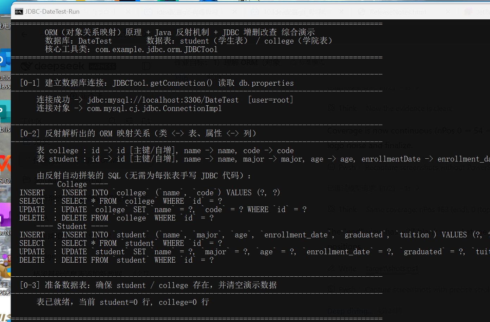
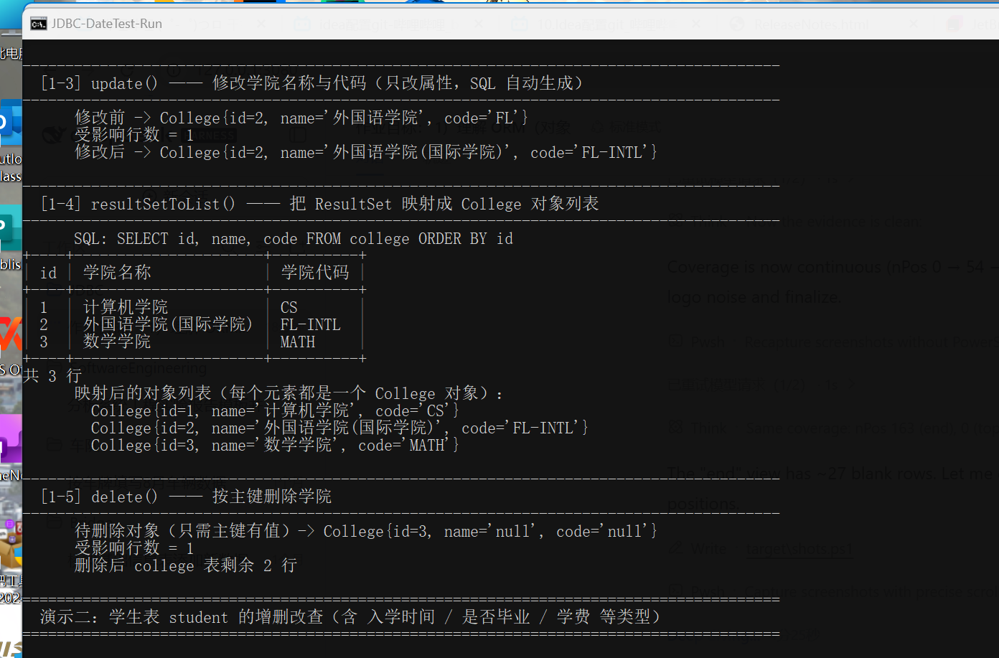
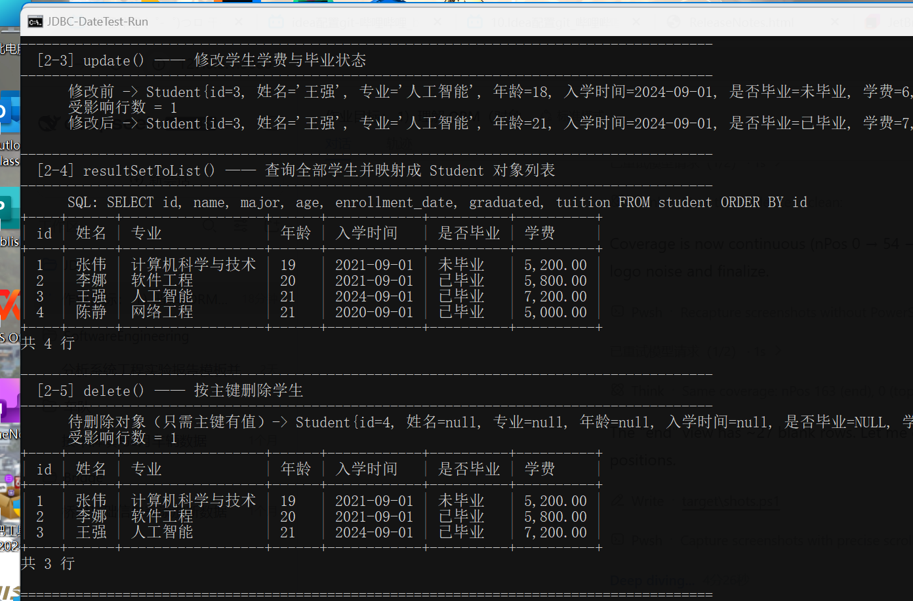
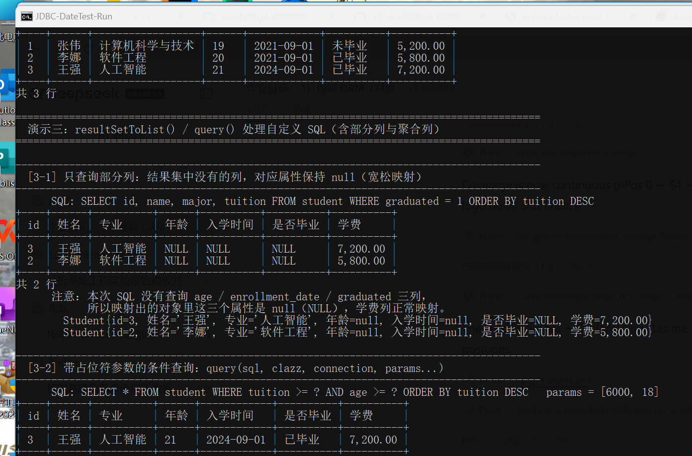

# ORM 原理 + Java 反射 + JDBC 增删改查（数据库 DateTest）

> 一个用 Maven 构建、用 git 管理版本的 JDBC 综合作业：手写一个「迷你 ORM」工具类 `JDBCTool`，
> 借助 **Java 反射**把 `ResultSet` 自动映射成 Java 对象、把 Java 对象自动映射成 SQL 语句，
> 并用它完成数据库 `DateTest` 中 **学生表 student** 与 **学院表 college** 的增删改查。

---

## 一、作业目标与实现对照

| 作业要求 | 本项目实现 |
| --- | --- |
| 1）理解 ORM（对象关系映射）的基本原理 | `@Table` / `@Column` / `@Id` 注解描述「类↔表、属性↔列」；`JDBCTool` 自动生成 SQL 并回填结果（见第三节） |
| 2）掌握 Java 反射在对象创建与属性赋值中的应用 | `newInstance()`（`Constructor#newInstance`）、`setFieldValue()` / `getFieldValue()`（`Field#set/get` + `setAccessible(true)`） |
| 3）学会使用 JDBC 进行增删改查 | `DriverManager` 获取连接、`PreparedStatement` 参数绑定、`ResultSet` 读取、`try-with-resources` 释放资源 |
| 4）实现 `JDBCTool` 工具类（4 个方法 + 5 个方法 + 辅助方法） | 见第四节方法清单，共 **5 个核心方法 + 11 个辅助方法** |
| 5）创建数据库 `DateTest`，含学生表、学院表 | `sql/date_test.sql`；`student(id,name,major,age,enrollment_date,graduated,tuition)`、`college(id,name,code)` |
| 6）用 `JDBCTool` 实现对两张表的增删改查 | `DateTestApp` 演示一（学院表）、演示二（学生表）、演示三（自定义 SQL） |
| 7）用 Maven 构建 | `pom.xml`（mysql-connector-j、JUnit 5、shade 可执行 fat jar） |
| 8）用 git 实现版本管理 | 已初始化 git 仓库，按功能分多次提交（见第七节） |
| 9）运行效果截图 | `docs/screenshots/run-01-top.png` ~ `run-04-end.png`（见第六节） |
| 10）仓库 URL | 见文档末尾「仓库地址」 |

---

## 二、项目结构

```
JDBC/
├── pom.xml                          Maven 构建文件（Java 21 + MySQL 驱动 + JUnit5 + shade 打可执行 jar）
├── .gitignore
├── README.md
├── sql/
│   └── date_test.sql               建库建表 + 初始化数据脚本
├── docs/
│   └── screenshots/                运行效果截图（4 张）
└── src/
    ├── main/
    │   ├── java/com/example/jdbc/
    │   │   ├── orm/
    │   │   │   ├── JDBCTool.java            ★ 核心工具类（5 个方法 + 辅助方法）
    │   │   │   ├── DataAccessException.java 统一运行时异常
    │   │   │   └── annotation/
    │   │   │       ├── Table.java           类 -> 表
    │   │   │       ├── Column.java          属性 -> 列
    │   │   │       └── Id.java              主键（支持自增）
    │   │   ├── entity/
    │   │   │   ├── Student.java             学生实体 -> student 表
    │   │   │   └── College.java             学院实体 -> college 表
    │   │   └── demo/
    │   │       ├── DateTestApp.java         ★ 演示主程序（main）
    │   │       └── ConsoleTable.java        控制台表格打印（中文对齐）
    │   └── resources/
    │       └── db.properties                数据库连接配置
    └── test/java/com/example/jdbc/orm/
        └── JDBCToolTest.java                7 个单元测试，覆盖 5 个核心方法
```

---

## 三、ORM 基本原理与本项目实现

**ORM（Object Relational Mapping，对象关系映射）** 要解决的核心矛盾是：
数据库里是「表和行、列」，Java 里是「类和对象、属性」，两者的表达方式不一致。
ORM 的职责就是在两者之间做双向翻译：

```
        Java 世界                          │           数据库世界
------------------------------------------│------------------------------------
 类  College                              │  表  college
 属性 id / name / code                    │  列  id / name / code
 对象 new College("计算机学院","CS")       │  行  (1, '计算机学院', 'CS')
------------------------------------------│------------------------------------
 对象  ---(反射取值 + 拼 SQL)---> INSERT/UPDATE/DELETE --->  数据库
 数据库 ---(ResultSet)---(反射赋值)---> 对象列表
```

### 3.1 映射关系用注解描述

```java
@Table("student")                      // 类  -> 表
public class Student {
    @Id(autoIncrement = true)          // 主键（自增）
    @Column("id") private Integer id;

    @Column("enrollment_date")         // 属性 -> 列（下划线命名）
    private LocalDate enrollmentDate;  // 入学时间

    @Column("graduated")   private Boolean graduated;      // 是否毕业
    @Column("tuition")     private BigDecimal tuition;     // 学费
    // ...
}
```

没有写 `@Column` 的属性，`JDBCTool` 会按「驼峰转下划线」的约定推导列名
（`enrollmentDate → enrollment_date`），也就是 **约定优于配置**。

### 3.2 反射在其中的三处关键作用

| 环节 | 用到的反射 API | 说明 |
| --- | --- | --- |
| 读映射信息 | `Class#getAnnotation`、`Class#getDeclaredFields` | 运行时读取 `@Table/@Column/@Id`，拿到「属性↔列」的对应关系（解析结果缓存到 `ConcurrentHashMap`，不用每次重复解析） |
| 创建对象 | `Class#getDeclaredConstructor` + `Constructor#newInstance` | 不需要 `new` 具体类型，`JDBCTool` 就能为任意实体创建实例 |
| 属性读写 | `Field#setAccessible(true)` + `Field#set/get` | 直接写入 `private` 属性，因此实体不需要写 setter 逻辑，泛型 `<T>` 让一套代码服务所有类型 |

此外还有**类型转换**：数据库的 `DATE → LocalDate`、`TINYINT(1) → Boolean`、
`DECIMAL → BigDecimal`、字符串主键 `"2" → Integer`，都由 `convertValue()` 按属性类型自动完成。

### 3.3 由反射自动生成的 SQL（程序运行时会打印出来）

```
---- College ----
INSERT : INSERT INTO `college` (`name`, `code`) VALUES (?, ?)
SELECT : SELECT * FROM `college` WHERE `id` = ?
UPDATE : UPDATE `college` SET `name` = ?, `code` = ? WHERE `id` = ?
DELETE : DELETE FROM `college` WHERE `id` = ?

---- Student ----
INSERT : INSERT INTO `student` (`name`, `major`, `age`, `enrollment_date`, `graduated`, `tuition`) VALUES (?, ?, ?, ?, ?, ?)
UPDATE : UPDATE `student` SET `name` = ?, `major` = ?, `age` = ?, `enrollment_date` = ?, `graduated` = ?, `tuition` = ? WHERE `id` = ?
DELETE : DELETE FROM `student` WHERE `id` = ?
```

可见：**新增 / 更新 / 删除 / 按主键查询这四类 SQL，一张表都不用自己写**，
新增一张表只需要再定义一个实体类 + 加注解即可。

所有条件值一律使用 `PreparedStatement` 的 `?` 占位符 + `setObject()` 绑定，避免 SQL 注入。

---

## 四、JDBCTool 方法清单

### 4.1 五个核心方法（作业要求的方法 1 ~ 方法 5）

| # | 方法签名 | 说明 |
| --- | --- | --- |
| 1 | `static <T> List<T> resultSetToList(ResultSet rs, Class<T> clazz)` | 把结果集逐行映射成对象列表；结果集列名与属性/列名宽松匹配（忽略大小写与下划线），多余的列自动忽略 |
| 2 | `static <T> int save(T obj, Connection connection)` | INSERT；自动跳过自增主键，并用 `getGeneratedKeys()` 把生成的主键**反射回填**到对象 |
| 3 | `static <T> int update(T obj, Connection connection)` | UPDATE；`SET` 为除主键外的全部属性，`WHERE` 用 `@Id` 属性值 |
| 4 | `static <T> int delete(T obj, Connection connection)` | DELETE；只需对象的主键有值 |
| 5 | `static <T> T getOneById(String id, Class<T> clazz, Connection connection)` | 按主键查询单个对象；字符串主键按主键属性类型自动转换；查不到返回 `null` |

### 4.2 辅助方法

| 分类 | 方法 | 作用 |
| --- | --- | --- |
| 连接管理 | `getConnection()` | 读 `db.properties`、加载驱动、`DriverManager` 建连 |
| | `loadConfig(String)` / `getUrl()` / `getUsername()` / `describeConnection()` | 配置加载与展示 |
| | `close(AutoCloseable...)` | 安静关闭 ResultSet/Statement/Connection |
| 通用访问 | `query(sql, clazz, connection, params...)` | 任意 SELECT + 参数绑定，内部复用方法 1 |
| | `executeUpdate(sql, connection, params...)` | 任意 DML/DDL |
| | `count(tableName, connection)` | 统计行数 |
| 映射元数据 | `tableNameOf` / `idColumnOf` / `describeMapping` / `describeSql` | 反射解析结果的可视化（教学与排查用） |
| 反射工具 | `newInstance` / `getFieldValue` / `setFieldValue` | 对象创建与属性读写 |
| | `convertValue(Class,Object)` | 数据库类型 ↔ Java 类型转换 |
| | `toSnakeCase(String)` | 驼峰转下划线（约定优于配置） |
| SQL 拼装 | `buildInsertSql` / `buildUpdateSql` / `buildDeleteSql` / `buildSelectByIdSql` | 由元数据拼 SQL |
| | `bindFields` / `bindParams` / `fillGeneratedKey` | 参数绑定与自增主键回填 |

---

## 五、数据库设计（DateTest）

```sql
CREATE DATABASE `DateTest` DEFAULT CHARACTER SET utf8mb4;
```

### 学生表 student

| 列名 | 类型 | 说明 | 对应 Java 属性 |
| --- | --- | --- | --- |
| id | INT AUTO_INCREMENT | 主键 Id | `Integer id` |
| name | VARCHAR(64) | 姓名 | `String name` |
| major | VARCHAR(64) | 专业 | `String major` |
| age | INT | 年龄 | `Integer age` |
| enrollment_date | DATE | 入学时间 | `LocalDate enrollmentDate` |
| graduated | TINYINT(1) | 是否毕业（1 是 / 0 否） | `Boolean graduated` |
| tuition | DECIMAL(10,2) | 学费 | `BigDecimal tuition` |

### 学院表 college

| 列名 | 类型 | 说明 | 对应 Java 属性 |
| --- | --- | --- | --- |
| id | INT AUTO_INCREMENT | 主键 | `Integer id` |
| name | VARCHAR(64) | 学院名称 | `String name` |
| code | VARCHAR(32) | 学院代码（唯一） | `String code` |

---

## 六、运行方法

### 6.1 环境要求

- JDK 17+（本项目使用 **Java 21** 编译）
- Maven 3.6+
- MySQL 8.x（本项目在 MySQL 8.4 上验证）

### 6.2 步骤

```bash
# 1. 初始化数据库（会重建数据库 DateTest 并插入初始数据）
mysql -uroot -p < sql/date_test.sql

# 2. 修改数据库账号密码（如与本机不同）
#    编辑 src/main/resources/db.properties

# 3. 编译 + 跑单元测试 + 打可执行 jar
mvn clean package

# 4. 运行演示程序（两种方式任选）
java -jar target/jdbc-orm-datetest-1.0.0.jar
mvn exec:java
```

> 演示程序启动时会先清空 `student` / `college` 两张表再插入演示数据，
> 这样每次运行的输出完全一致，方便反复演示与截图；
> 运行结束后数据会真实保留在数据库里，可用 `SELECT * FROM student;` 复核。

### 6.3 运行效果截图

在真实 Windows 控制台（170 列 × 57 行）中运行 `java -jar target/jdbc-orm-datetest-1.0.0.jar` 的效果：

**截图 1／4：建立连接、反射解析出的 ORM 映射关系、由反射自动生成的 SQL、演示一 学院表新增**



**截图 2／4：学院表查询与删除、演示二 学生表 save / getOneById / update**



**截图 3／4：学生表 resultSetToList() 表格输出、按主键 delete**



**截图 4／4：演示三 自定义 SQL 与聚合查询的宽松映射、最终记录数与耗时**



### 6.4 单元测试

```bash
mvn test
```

```
[INFO] Tests run: 7, Failures: 0, Errors: 0, Skipped: 0 -- in com.example.jdbc.orm.JDBCToolTest
```

7 个用例分别覆盖 `save` / `getOneById` / `update` / `delete` /
`resultSetToList`（含类型转换与部分列映射）/ 辅助方法（命名转换、类型转换）。
若本机没有可用的 MySQL，测试会通过 `Assumptions.abort` **自动跳过**而不是让构建失败。

---

## 七、git 版本管理

仓库按「骨架 → ORM 内核 → 实体 → 演示 → SQL → 测试 → 文档」的顺序提交，
每次提交只做一件事：

```bash
git log --oneline
```

| 提交 | 内容 |
| --- | --- |
| `chore` | Maven 骨架：pom.xml、.gitignore、db.properties |
| `feat(orm)` | ORM 注解、异常、JDBCTool 核心工具类 |
| `feat(entity)` | Student / College 实体 |
| `feat(demo)` | DateTestApp 演示程序 + ConsoleTable |
| `feat(sql)` | DateTest 建库建表脚本 |
| `test` | JDBCTool 单元测试 |
| `docs` | README 与运行截图 |

---

## 八、已知限制与可扩展点

- `resultSetToList` 只做「列名 ↔ 属性名」的匹配，**不支持关联对象映射**（比如学生里直接放一个 College 对象）；
  如需支持可在实体里加 `college_id` 并扩展 `RowMapper` 做二次查询或 JOIN 映射。
- 未实现连接池、一级缓存、懒加载、事务模板，这些是 Hibernate / MyBatis 相对手写 ORM 的增强点。
- `update` 采用「全字段更新」，不是动态 SQL（不会跳过 null 字段）。
- `db.properties` 中保存了明文口令，仅用于本地教学演示；生产环境应改用环境变量或密钥管理。

---

## 仓库地址

| 项目 | 地址 |
| --- | --- |
| **GitHub 远程仓库（`origin`）** | **https://github.com/G1nkoSora99/Java.git** |
| 本地工作仓库 | `D:\javacode\JDBC` |
| 本机镜像裸库（`local`） | `file:///D:/javacode/JDBC-remote.git` |

GitHub 仓库 `G1nkoSora99/Java` 已配置为 `origin`，首次推送命令：

```bash
git push -u origin main
```

> **推送状态**：完整提交历史已推送到 GitHub `origin`（分支 `main`），本地 `main`、`origin/main`
> 与镜像 `local/main` 三者哈希一致。
> 推送后已用**从 GitHub 全新 clone + `mvn test`（7 个用例全部通过）**验证：
> 克隆下来的文件齐全、提交历史完整，仓库开箱即可构建运行。
> 另外保留了一个本机镜像裸库 `local`（`file:///D:/javacode/JDBC-remote.git`）作为离线备份。
>
> 后续更新只需：
>
> ```bash
> git add -A
> git commit -m "你的提交说明"
> git push origin main
> ```


